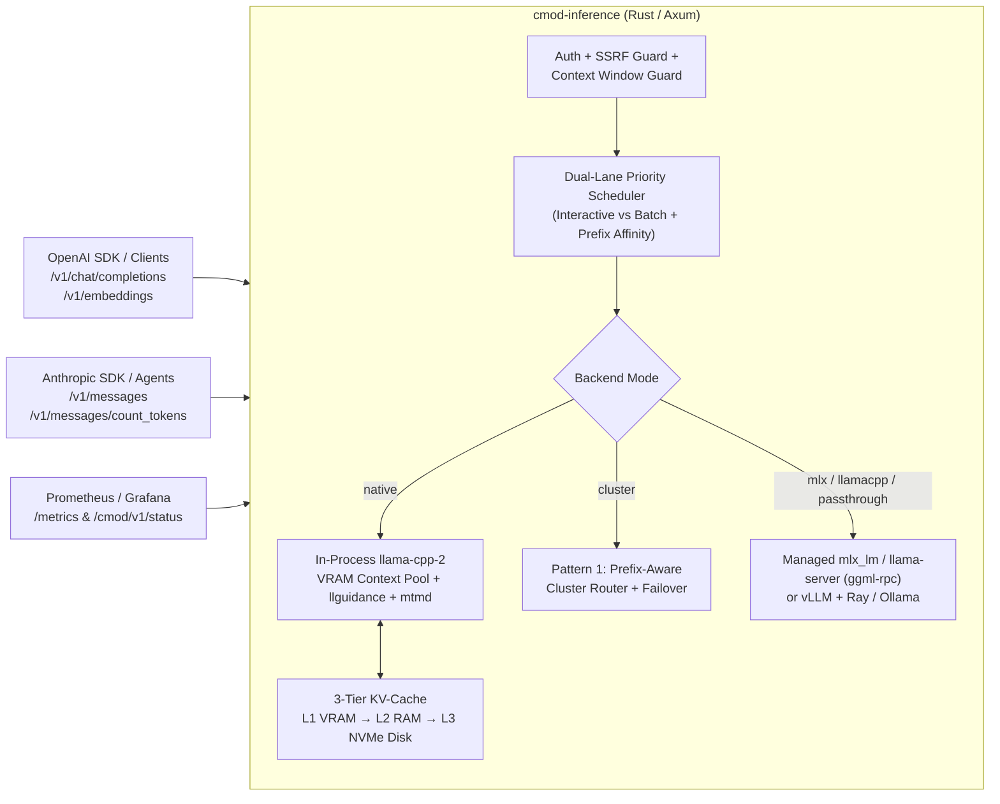

# cmod-inference

**Standalone, multi-GPU & multi-machine local AI inference server written in Rust.**

`cmod-inference` combines a **dual-protocol API gateway** (native OpenAI + Anthropic), an **in-process Level-2 GGUF engine** (`llama-cpp-2`), **`llguidance` constrained decoding**, a **3-Tier KV-Cache (L1 VRAM → L2 Host RAM → L3 NVMe Disk)**, **Dual-Lane Priority Scheduling**, **Prometheus `/metrics`**, **Embeddings (`/v1/embeddings`)**, and **Multi-Machine Cluster Routing** into a single cross-platform binary.



---

## Key Features

- **Built-in Web GUI (`cmod Studio` at `http://127.0.0.1:8790/`):**
  - ChatGPT/Claude/OpenWebUI-style streaming chat with persistent local conversation history, safe Markdown & code-block rendering, collapsible Thinking blocks, live `tok/s` & `TTFT`, multimodal image upload (auto-guarded when `--mmproj` is active), Live Monitor, Model Manager/Downloader, and IDE Setup snippets.
- **Universal Open-Weight Tool & Thinking Parser (Zero-Config Auto-Detection):**
  - Supports **Qwen 2.5/3/3.5/3.8**, **MiMo-V2.6**, **Mistral v3 / Ministral-3 / Devstral**, **Google Gemma 4** (`<|tool>declaration:...`, `<|tool_call>call:...`, `<|channel>thought`), **DeepSeek V3/R1**, **OpenAI `gpt-oss` Harmony**, **Kimi-K2**, **GLM-4.5**, and **Llama 3/4** with bare-JSON fallback & lenient JSON quote/brace repair.
- **Speculative Decoding (`--mtp` & `--draft-model`) + LoRA Adapters (`--lora`):**
  - Native same-model **Multi-Token Prediction (`--mtp`)** via `llama_cpp_2::speculative::MtpSpeculative` and universal external **`--draft-model <path.gguf>`** (`--draft-max N`).
  - In-process GGUF **LoRA adapter** hot-loading (`--lora ./adapter.gguf[:scale]`).
  - Global **`--no-think`** flag + OpenAI `reasoning_effort` parsing, and **auto-pruning of old `tool_result` blocks** + `max_tokens` auto-clamping to prevent premature `context_length_exceeded` errors in long coding-agent sessions.
- **Dual Native Protocols:**
  - **OpenAI:** `POST /v1/chat/completions` (streaming & non-streaming), `GET /v1/models`, `GET /v1/models/{id}`
  - **Anthropic:** `POST /v1/messages` (full SSE event sequence & `cache_control`), `POST /v1/messages/count_tokens`
- **In-Process Level-2 Native Engine (`llama-cpp-2`):**
  - Supports **Apple Metal**, **NVIDIA CUDA**, **AMD ROCm**, **Vulkan**, and **CPU** from a single Rust codebase.
  - Persistent **VRAM Context Pool** (`--slots 1..16`) preventing per-request OOM spikes.
  - **Persistent Multimodal VLM (`mtmd`):** pre-loads `mmproj` once per worker slot for local image/OCR inference.
- **In-Process `llguidance` Constrained Decoding:**
  - 100% schema-compliant JSON (`response_format: json_schema` / `json_object`).
  - Grammar-constrained forced tool calling (`tool_choice: "required"` / named tool) across all model families.
- **3-Tier Prefix KV-Cache (`L1 VRAM → L2 Host RAM → L3 NVMe Disk`):**
  - Zero-copy L1 VRAM prefix trimming, L2 Host RAM LRU cache, and persistent L3 NVMe Disk `.kvcache` snapshots.
  - Post-response flush keeps Run 1 user latency unaffected while persisting prefix caches across server restarts and **across OpenAI ↔ Anthropic protocols**.
- **Per-Request Thinking Control & Verbose Telemetry:**
  - OpenAI: `"enable_thinking": false | true` (or `"think"`, `"chat_template_kwargs"`).
  - Anthropic: `"thinking": { "type": "disabled" | "enabled" }`.
  - Pass `"verbose": true` or header `X-Cmod-Verbose: 1` for per-request latency, `tokens_per_sec`, slot, and cache hit telemetry.
- **Multi-GPU & Offloading:**
  - Partial GPU/CPU layer offloading (`--gpu-layers`).
  - **MoE Expert CPU Offload** (`--moe-cpu-offload`) keeping Attention & KV-Cache in VRAM while offloading MoE experts to Host RAM.
  - Multi-GPU split modes (`--split-mode layer|row|tensor|none`), custom VRAM ratios (`--tensor-split 24,12`), and `--main-gpu`.
- **Multi-Machine Scaling (3 Built-in Patterns):**
  - **Pattern 1 — Prefix-Aware Cluster Router (`--backend cluster`):** model-based routing, consistent `prefix_hash` affinity, and automatic failover.
  - **Pattern 2a — Distributed GGUF Sharding (`--backend llamacpp --rpc-servers ...`):** `ggml-rpc` across LAN/Thunderbolt.
  - **Pattern 2b — Enterprise NVIDIA Cluster (`vLLM + Ray`):** ready-to-use `deploy/docker-compose.vllm-ray.yml`.
  - **Managed Apple MLX (`--backend mlx`):** auto-manages `mlx_lm.server` on Apple Silicon with a single command.
- **Security & Guardrails:**
  - Fail-closed API key authentication required when binding to non-loopback (`0.0.0.0`).
  - Built-in **SSRF guard** rejecting remote `http/https` image URLs (base64 `data:` images only).
  - Explicit `400 context_length_exceeded` guard (no silent prompt truncation).
  - **Dual-Lane Priority Scheduler** isolating `Interactive` UI chat from heavy `Batch` jobs (`X-Cmod-Priority: batch`).
- **Hardware-Aware Model Catalog & Downloader:**
  - Auto-detects Apple Silicon Metal, NVIDIA CUDA, AMD ROCm, Vulkan, and RAM.
  - 30 curated 2025–2026 GGUF models (0.6B to 35B MoE) with capability badges (`Multimodal/Vision`, `OCR`, `Thinking`, `Hybrid-Think`, `Non-Thinking`, `MoE`, `Coding/Agent`).

---

## Supported Libraries, Model Formats & Hardware

### Drop-In Client SDKs & Ecosystem Support

Because `cmod-inference` natively implements both the **OpenAI** and **Anthropic** wire protocols, it works out-of-the-box with major SDKs and agent frameworks:

- **OpenAI Ecosystem:** `openai` (Python / TypeScript / Go), Vercel AI SDK, LangChain, LlamaIndex, LiteLLM, Open WebUI, Continue.dev — set `base_url="http://127.0.0.1:8790/v1"`.
- **Anthropic Ecosystem:** `anthropic` (Python), `@anthropic-ai/sdk` (TypeScript), and Anthropic-compatible agent runners — set `base_url="http://127.0.0.1:8790"`.

**Python (OpenAI SDK):**
```python
from openai import OpenAI

client = OpenAI(base_url="http://127.0.0.1:8790/v1", api_key="local-key")
resp = client.chat.completions.create(
    model="qwen3-4b-doc",
    messages=[{"role": "user", "content": "Hello from OpenAI SDK!"}],
    extra_body={"enable_thinking": False, "verbose": True},
)
print(resp.choices[0].message.content)
```

**Python (Anthropic SDK):**
```python
import anthropic

client = anthropic.Anthropic(base_url="http://127.0.0.1:8790", api_key="local-key")
msg = client.messages.create(
    model="qwen3-4b-doc",
    max_tokens=256,
    messages=[{"role": "user", "content": "Hello from Anthropic SDK!"}],
)
print(msg.content[0].text)
```

### Supported Formats, Model Families & Hardware Matrix

| Category | Supported Options | Backend Mode |
|---|---|---|
| **Model Formats** | **GGUF** (Q4_K_M, Q8_0, UD-Q4_K_XL, etc. + `mmproj` VLM) | `native` (in-process), `llamacpp` |
| | **Apple MLX** (4-bit / 8-bit MLX models on Apple Silicon) | `mlx` (managed `mlx_lm.server`) |
| | **Safetensors / FP8 / AWQ / GPTQ** | `vllm`, `passthrough` (vLLM, SGLang, mistral.rs, Ollama) |
| **Model Families** | **Qwen3 / Qwen3.5 / Qwen3-VL / Qwen3-Coder**, **Gemma 4 / Gemma 3**, **DeepSeek-R1**, **gpt-oss MoE**, **Mistral Small 3.2 / Devstral**, **Phi-4**, **GLM-4**, **SmolLM3**, **Llama 3/4** | All GGUF architectures supported by `llama.cpp` |
| **Hardware & OS** | **macOS Apple Silicon** (Metal & MLX), **NVIDIA** (CUDA), **AMD** (ROCm), **Intel/Cross-Vendor** (Vulkan), **CPU** (AVX2/AVX-512/NEON) | Build feature: `metal`, `cuda`, `rocm`, `vulkan`, or `native` |

### Core Rust Stack

- **Inference & Multimodal:** [`llama-cpp-2`](https://crates.io/crates/llama-cpp-2) (`ggml` + `mtmd` vision projector)
- **Constrained Decoding:** [`llguidance`](https://crates.io/crates/llguidance) & [`toktrie`](https://crates.io/crates/toktrie) (in-process JSON Schema & tool-call grammar)
- **HTTP & Async Runtime:** [`axum`](https://crates.io/crates/axum), [`tokio`](https://crates.io/crates/tokio), [`tower-http`](https://crates.io/crates/tower-http), [`reqwest`](https://crates.io/crates/reqwest)
- **CLI & System Telemetry:** [`clap`](https://crates.io/crates/clap), [`sysinfo`](https://crates.io/crates/sysinfo)

---

## Benchmarks (Apple M4 Pro, 24 GB Unified Memory)

Measured head-to-head against **Ollama `v0.40.16`** using the **exact same GGUF model files**, `ctx=8192`, `temperature=0.0`, and `--release` build:

### `Qwen3-4B-Instruct-2507-Q4_K_M.gguf` (2.38 GB, Non-Thinking)

| Scenario | `cmod-inference` (`--release`) | Ollama `v0.40.16` | Result |
|---|---:|---:|---|
| **Boot + Warmup** | **1,229 ms** (`818` boot + `411` warmup) | 3,983 ms | **3.2× faster** cold start |
| **Direct Chat** *(3× avg, 128 tok)* | **2,608 ms** (**49.1 tok/s**) | 3,086 ms (`41.5 tok/s`) | **+18.3% faster** decode |
| **Strict JSON Schema** *(3× avg)* | **1,054 ms** (**3/3 valid**) | 1,102 ms (**3/3 valid**) | **48 ms faster** |
| **KV-Cache Reuse** *(~1,822 tok prompt)* | R1 `4,236 ms` → R2 **`1,084 ms`** → R3 **`676 ms`** | R1 `4,004 ms` → R2 `1,112 ms` → R3 `956 ms` | **29% faster** warm cache |
| **Post-Restart / Unload** *(~1,822 tok)* | Reboot `1,028 ms` + Req **`1,041 ms`** (`l3DiskHits=1`) | Reload + Req `5,328 ms` | **5.1× faster** request (**2.6×** incl. reboot) |

### `Qwen3-0.6B-Q4_K_M.gguf` (378 MB, Hybrid-Think)

| Scenario | `cmod-inference` (`--release`) | Ollama `v0.40.16` | Result |
|---|---:|---:|---|
| **Warmup** | **428 ms** | 4,489 ms | **10.5× faster** |
| **Chat Non-Thinking** *(3× avg)* | **420 ms** (`228.4 tok/s`, think leak **0/3**) | 427 ms (`224.9 tok/s`, think leak **3/3**) | `enable_thinking: false` honored |
| **Strict JSON Schema** *(3× avg)* | **386 ms** (**3/3 valid JSON**) | 349 ms (**0/3 valid**, empty `content`) | **100% vs 0%** JSON reliability |
| **Post-Restart / Unload** *(~1,831 tok)* | Reboot `309 ms` + Req **`171 ms`** (`l3DiskHits=1`) | Reload + Req `1,667 ms` | **9.7× faster** request |

---

## Build & Installation

### Build from Source

Choose the Cargo feature matching your hardware:

```bash
# macOS (Apple Silicon Metal + Multimodal VLM + llguidance)
cargo build --release --features "metal multimodal"

# Linux / Windows (NVIDIA CUDA)
cargo build --release --features "cuda multimodal"

# Linux (AMD ROCm)
cargo build --release --features "rocm multimodal"

# Cross-vendor GPU (Vulkan)
cargo build --release --features "vulkan multimodal"

# CPU-only
cargo build --release --features "native grammar multimodal"
```

Install the CLI to your `PATH`:

```bash
mkdir -p ~/.local/bin
cp target/release/cmod-inference ~/.local/bin/cmod-inference
ln -sf ~/.local/bin/cmod-inference ~/.local/bin/cmod
```

---

## Quick Start

```bash
# 1. Inspect hardware & get model recommendations for your GPU/VRAM
cmod hardware
cmod recommend

# 2. Download a curated GGUF model (e.g., 4B non-thinking or 0.6B tiny)
cmod pull qwen3-4b-doc
cmod list

# 3. Start the Native Metal/CUDA server with 3-Tier KV-Cache
cmod serve \
  --backend native \
  --model-path ./models/Qwen3-4B-Instruct-2507-Q4_K_M.gguf \
  --model qwen3-4b-doc \
  --ctx 8192 \
  --slots 2 \
  --kv-cache-dir ./kvcache

# 4. Check live server status, slots, and L1/L2/L3 KV-Cache hits (like `ollama ps`)
cmod ps

# 5. Stop local server cleanly
cmod stop
```

---

## Usage Examples

### OpenAI API (`/v1/chat/completions`) — Strict JSON Schema + Verbose

```bash
curl -s http://127.0.0.1:8790/v1/chat/completions \
  -H "Content-Type: application/json" \
  -d '{
    "model": "qwen3-4b-doc",
    "enable_thinking": false,
    "verbose": true,
    "temperature": 0.0,
    "max_tokens": 128,
    "messages": [
      {"role": "user", "content": "Invoice: Specialist Visit qty 2 total 700000. Extract item, qty, total."}
    ],
    "response_format": {
      "type": "json_schema",
      "json_schema": {
        "name": "invoice_item",
        "strict": true,
        "schema": {
          "type": "object",
          "properties": {
            "item": {"type": "string"},
            "qty": {"type": "integer"},
            "total": {"type": "integer"}
          },
          "required": ["item", "qty", "total"],
          "additionalProperties": false
        }
      }
    }
  }'
```

### Anthropic API (`/v1/messages`)

```bash
curl -s http://127.0.0.1:8790/v1/messages \
  -H "Content-Type: application/json" \
  -H "anthropic-version: 2023-06-01" \
  -d '{
    "model": "qwen3-4b-doc",
    "max_tokens": 128,
    "thinking": {"type": "disabled"},
    "verbose": true,
    "messages": [
      {"role": "user", "content": "Summarize why local inference protects enterprise privacy in one sentence."}
    ]
  }'
```

### Multi-GPU & MoE CPU Offload

```bash
# Run a 30B MoE model on 16 GB VRAM + 32 GB RAM (Attention/KV in VRAM, experts in RAM)
cmod serve --backend native \
  --model-path ./models/Qwen3-30B-A3B-Instruct-2507-UD-Q4_K_XL.gguf \
  --gpu-layers -1 \
  --moe-cpu-offload

# Split across heterogeneous GPUs (e.g., 24 GB + 12 GB) with row parallelism
cmod serve --backend native \
  --model-path ./models/Qwen3-32B-Q4_K_M.gguf \
  --split-mode row \
  --tensor-split 24,12 \
  --main-gpu 0
```

### Multi-Machine Deployment

```bash
# Pattern 1: Prefix-Aware Horizontal Cluster Router (Model Routing + Failover)
cmod serve --backend cluster \
  --bind 0.0.0.0 --api-key "your-secret-key" \
  --cluster-nodes "http://192.168.1.10:8790/v1|qwen3-14b-doc,http://192.168.1.11:8790/v1|gemma-4-e4b-vlm"

# Pattern 2a: Distributed GGUF Sharding via ggml-rpc
cmod serve --backend llamacpp \
  --model-path ./models/Qwen3-32B-Q4_K_M.gguf \
  --rpc-servers "192.168.1.20:50052,192.168.1.21:50052" \
  --split-mode layer

# Pattern 2b: Enterprise NVIDIA vLLM + Ray Cluster
docker compose -f deploy/docker-compose.vllm-ray.yml up -d

# Managed Apple MLX (requires `pip install mlx-lm`)
cmod serve --backend mlx --model mlx-community/Qwen3-4B-Instruct-2507-4bit
```

---

## HTTP Endpoints

| Plane | Endpoint | Description |
|---|---|---|
| **OpenAI** | `POST /v1/chat/completions` | Chat completions (streaming, JSON schema, tools, base64 images) |
| **OpenAI** | `POST /v1/embeddings` | L2-normalized text embeddings (in-process GGUF or upstream/cluster) |
| **OpenAI** | `GET /v1/models`, `GET /v1/models/{id}` | List / inspect active model and presets |
| **Anthropic** | `POST /v1/messages` | Messages API (full SSE, thinking blocks, tool_use, prompt caching) |
| **Anthropic** | `POST /v1/messages/count_tokens` | Token count estimator |
| **Control** | `GET /healthz`, `GET /readyz` | Liveness and backend readiness probes |
| **Monitoring** | `GET /metrics` | Prometheus text exposition metrics for Grafana & alerting |
| **Telemetry** | `GET /cmod/v1/status` | Live backend, scheduler, 3-Tier KV-Cache, and hardware telemetry |
| **Telemetry** | `GET /cmod/v1/hardware`, `GET /cmod/v1/presets` | GPU/RAM hardware report & built-in presets |
| **Models** | `GET /cmod/v1/models/recommend` | 30 curated models scored for current hardware with capability tags |
| **Models** | `GET /cmod/v1/models/local` | List downloaded local `.gguf` files |
| **Models** | `POST /cmod/v1/models/pull`, `GET /cmod/v1/models/pull/{id}` | Start & monitor model downloads over HTTP |

---

## Running Tests

```bash
cargo test --features "metal multimodal"
```

---

## License

MIT
